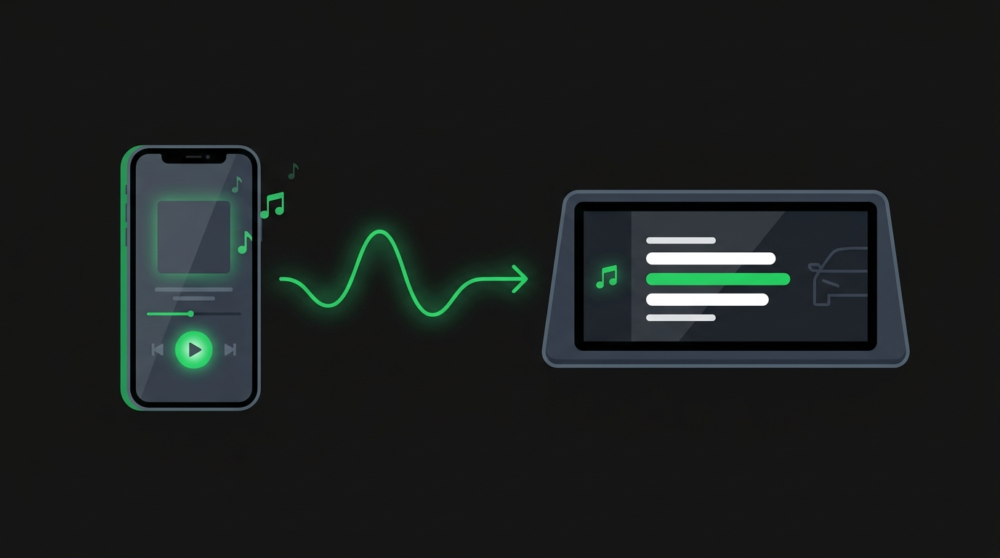

# Lirik Lagu untuk Android Auto

Aplikasi Android sederhana untuk **menampilkan lirik lagu yang sedang kamu putar di Spotify langsung ke layar Android Auto di mobil**.

---

## Apa Kegunaan Aplikasi Ini?

Saat memutar musik lewat Spotify di Android Auto, layar mobil biasanya hanya menampilkan judul lagu dan nama penyanyi. Dengan aplikasi ini, kamu bisa melihat lirik dari lagu yang sedang diputar langsung di layar mobil.

## Cara Kerja Singkat

1. Kamu mengaktifkan fitur bawaan **Device Broadcast Status** di pengaturan **Spotify** (tanpa perlu memberikan izin sensitif Akses Notifikasi).
2. Saat kamu memutar lagu di **Spotify**, Spotify mengirimkan broadcast judul lagu dan nama penyanyi ke aplikasi ini secara otomatis.
3. Lirik lagu langsung diambil dari internet dan ditampilkan di layar HP maupun di layar **Android Auto** mobilmu.

## Yang Kamu Butuhkan

- HP Android dengan aplikasi **Spotify** dan koneksi internet.
- Mobil atau layar head unit yang mendukung **Android Auto**.

## Cara Menggunakan

1. **Aktifkan Device Broadcast Status di Spotify:**
   - Buka aplikasi **Spotify** -> ketuk foto profil -> **Settings and privacy (Pengaturan dan privasi)**.
   - Scroll ke bagian **Apps and devices / Devices**, lalu aktifkan **Device Broadcast Status (Status Siaran Perangkat)**.
2. **Pasang dan buka aplikasi** di HP kamu untuk memastikan lagu dari Spotify sudah terdeteksi.
3. **Izinkan aplikasi tampil di Android Auto:**
   - Buka pengaturan **Android Auto** di HP.
   - Masuk ke **Setelan Developer** (ketuk bagian *Versi* berkali-kali hingga menu developer aktif).
   - Centang **Sumber tidak dikenal (Unknown sources)**.
4. **Hubungkan HP ke mobil**, buka daftar aplikasi di layar Android Auto, pilih **spotify lirik v1**, lalu buka menu **Lirik**.

> **Catatan:** Utamakan keselamatan berkendara. Gunakan tampilan lirik dengan bijak atau hanya untuk penumpang saat mobil berjalan.

---

## Kredit & Ucapan Terima Kasih

Terima kasih sebesar-besarnya kepada **[LRCLIB](https://lrclib.net)** beserta pembuatnya **[@tranxuanthang](https://github.com/tranxuanthang)** (repository: [tranxuanthang/lrclib](https://github.com/tranxuanthang/lrclib)) dan seluruh kontributor komunitasnya yang telah menyediakan layanan database lirik secara gratis, lengkap, dan terbuka.

Seluruh lirik lagu (baik lirik tersinkronisasi maupun lirik teks) yang ditampilkan pada aplikasi ini diambil menggunakan API dari **LRCLIB**.
